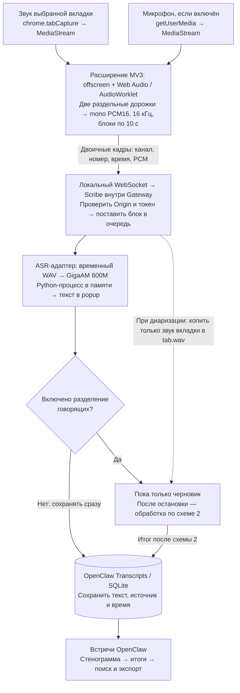
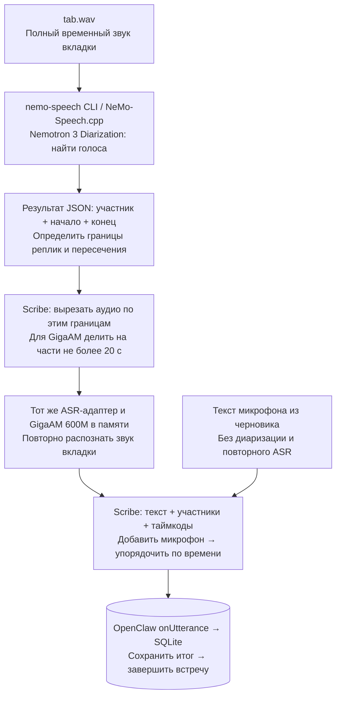

# Как звук превращается в стенограмму

Схема соответствует Scribe 0.3.0. Для примера выбран **GigaAM Multilingual
Large 600M**; ASR-движок заменяется через [настройки адаптера](asr.md).
**ASR** — распознавание слов, **диаризация** — определение, кто и когда говорил.

## 1. Во время записи

Звук вкладки и микрофона **не смешивается**: блоки идут по одному соединению,
но с разными метками `tab` и `mic`. Запись идёт сразу, а не ждёт готового файла
всей встречи. Распознавание выполняется порциями, не пословно.
Последний неполный блок досылается при нажатии **Остановить**.

Без диаризации текст сразу попадает в архив с метками **Вкладка / Микрофон**.
С диаризацией во время записи он показывается как **черновик**; в постоянный
архив затем попадёт только итог, без дублирования черновых реплик.

## 2. После остановки, если включено разделение говорящих

**Nemotron не распознаёт слова:** он возвращает временные интервалы голосов.
Поэтому после него ASR ещё раз обрабатывает соответствующие участки вкладки.
Микрофон остаётся источником **Микрофон**, а голоса вкладки получают метки
**Участник 1, Участник 2…**. При одновременной речи указывается несколько
участников, но смешанный звук не разделяется на чистые голосовые дорожки.

## Технологии и операции по шагам

| Этап | Технология | Что именно происходит |
| --- | --- | --- |
| Захват вкладки | Chrome/Opera MV3, `chrome.tabCapture`, offscreen document | Выбирается вкладка на момент старта; её MediaStream не меняется при переключении вкладок. Popup можно закрыть. |
| Захват микрофона | `getUserMedia` | При разрешённом доступе открывается отдельный поток с echo cancellation, noise suppression и auto gain control. Микрофон можно выключить. |
| Подготовка звука | `AudioContext` 16 кГц + `AudioWorklet` | Каналы каждой дорожки сводятся в mono, Float32 превращается в PCM16, собираются блоки по 10 с. |
| Доставка | WebSocket на `127.0.0.1:19789` по умолчанию | Двоичный кадр несёт канал, порядковый номер, смещение по времени и PCM. Gateway проверяет Origin, pairing-token и последовательность; возвращает ACK после обработки блока. |
| Очередь плагина | TypeScript/JavaScript внутри OpenClaw Gateway | Блоки обрабатываются последовательно. Почти цифровая тишина и фрагменты короче 0,2 с не отправляются в live-ASR. При переполнении очереди запись явно останавливается. |
| Вызов ASR | WAV + `child_process.spawn` + JSONL по stdin/stdout | Из PCM создаётся временный WAV. Дочернему процессу передаются путь к нему и язык, обратно приходит текст. HTTP-сервер между плагином и моделью не нужен. |
| Распознавание GigaAM | Python, официальный `gigaam`, FFmpeg, Torchaudio/PyTorch; CUDA или CPU по настройке | FFmpeg читает WAV, Torchaudio готовит log-mel признаки, модель CTC декодирует текст. Веса загружаются на первом запросе и переиспользуются до остановки плагина. На GPU encoder FP16; CTC не добавляет пунктуацию. |
| Разделение говорящих | `nemo-speech` / NeMo-Speech.cpp, Nemotron 3 Diarization | Только после остановки: обработать полный WAV вкладки, вернуть интервалы голосов в JSON, повторно распознать эти интервалы выбранным ASR. |
| Постоянное хранение и показ | OpenClaw Transcript Source Provider, `onUtterance`, SQLite, Control UI | Плагин передаёт текст, ID/метку говорящего и время. OpenClaw хранит реплики, формирует итоги, предоставляет «Встречи», поиск и экспорт. |

Резидентный JSONL-процесс в таблице — путь GigaAM и backend `worker`.
В режиме `openclaw` используется штатный локальный аудио-CLI хоста, вызываемый
на каждый блок. Детали выбора движка — в [контракте ASR](asr.md).

## Что остаётся после обработки

- **Постоянно:** текст, таймкоды, метки говорящих и итоги в штатной SQLite-базе
  OpenClaw — `<stateDir>/state/openclaw.sqlite`.
- **При экспорте:** JSONL стенограммы, Markdown/JSON итогов и метаданные.
  Это выгрузки из SQLite, а не отдельное рабочее хранилище Scribe.
- **Временный WAV отдельного ASR-запроса:** удаляется после ответа или ошибки.
- **При диаризации:** полный `tab.wav` и резервный текст временно находятся
  в `<stateDir>/scribe/work/recording-*`. После успешного сохранения итога
  удаляются. Полная запись микрофона не накапливается.
- **При сбое диаризации/итогового ASR:** сохраняется черновик без разделения,
  показывается предупреждение; временный WAV вкладки и журнал остаются для
  восстановления. При ошибке сохранения или аварийном завершении Gateway
  они также могут остаться; автоматического восстановления нет.

Обычный режим без диаризации не собирает полную запись встречи.
Распознавание и диаризация здесь локальные; **итоги по тексту создаёт OpenClaw**
согласно собственной настройке моделей. Это не задача GigaAM или Nemotron,
и локальный ASR сам по себе не означает, что настроенная модель итогов локальна.

## Где это реализовано

| Часть пути | Код |
| --- | --- |
| Выбор вкладки и запуск захвата | [background.ts](https://github.com/Efreh/openclaw-scribe/blob/main/src/extension/background.ts) |
| Две дорожки, соединение, получение текста, остановка | [offscreen.ts](https://github.com/Efreh/openclaw-scribe/blob/main/src/extension/offscreen.ts) |
| PCM16 и блоки аудио | [worklet.ts](https://github.com/Efreh/openclaw-scribe/blob/main/src/extension/worklet.ts), [protocol.ts](https://github.com/Efreh/openclaw-scribe/blob/main/src/shared/protocol.ts) |
| Очередь, черновик/итог, передача в OpenClaw | [server.ts](https://github.com/Efreh/openclaw-scribe/blob/main/src/plugin/server.ts), [index.ts](https://github.com/Efreh/openclaw-scribe/blob/main/src/plugin/index.ts) |
| Временные WAV, адаптеры и резидентный процесс | [asr.ts](https://github.com/Efreh/openclaw-scribe/blob/main/src/plugin/asr.ts), [gigaam-worker.py](https://github.com/Efreh/openclaw-scribe/blob/main/src/plugin/gigaam-worker.py) |
| Полный звук вкладки, интервалы голосов, повторный ASR | [diarization.ts](https://github.com/Efreh/openclaw-scribe/blob/main/src/plugin/diarization.ts) |

Формат штатного архива и экспортов: [OpenClaw Transcripts](https://docs.openclaw.ai/cli/transcripts).
