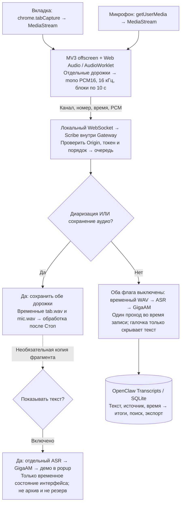
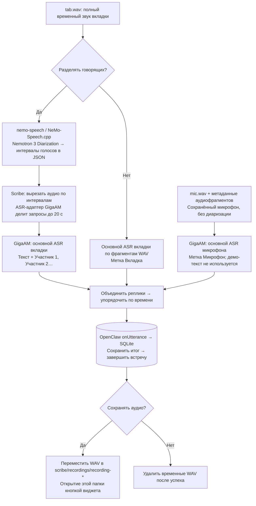

# Как звук превращается в стенограмму

Схема соответствует Scribe 0.5.0. Для примера выбран **GigaAM Multilingual
Large 600M**; ASR-движок заменяется через [настройки адаптера](asr.md).
**ASR** — распознавание слов, **диаризация** — определение, кто и когда говорил.

## 1. Во время записи

Дорожки **не смешиваются**. Аудиоблоки всегда передаются на Gateway:
при полной записи они нужны для временной записи, даже когда демо выключено.
Последний неполный блок досылается при **Остановить**.

**Без диаризации и без сохранения аудио** ASR работает во время записи, текст сразу сохраняется
с метками **Вкладка / Микрофон**. Повторного ASR после остановки нет.

**С диаризацией или сохранением аудио** основной ASR ждёт остановки. Галочка **Показывать текст**
управляет только дополнительным демо обеих дорожек. Выключена — живых вызовов
ASR нет. Включена — GigaAM обрабатывает копии фрагментов для просмотра.
Эти тексты не записываются в файлы, SQLite или резервный журнал и никогда
не переиспользуются для итогов, включая микрофон. В интерфейсе сохраняются
только последние 100 строк во временном состоянии браузерной сессии.

Переключение галочки действует на новые демо-запросы. Уже запущенный запрос
может завершиться, но после выключения его ответ игнорируется. Очередь демо
ограничена: медленная или ошибочная демонстрация не останавливает запись
основного аудио. Закрытие popup само по себе галочку не меняет.

## 2. После остановки в режиме полной записи

Основной путь **одинаков при включённом и выключенном демо**. Без демо
каждый обрабатываемый участок аудио проходит ASR только один раз.
Включение демо сознательно добавляет отдельные вычисления ради просмотра.

Nemotron не распознаёт слова и получает только вкладку. Микрофон остаётся
источником **Микрофон**. При одновременной речи во вкладке указывается несколько
участников, но смешанный звук не разделяется на чистые голосовые дорожки.

## Технологии и операции по шагам

| Этап | Технология | Что именно происходит |
| --- | --- | --- |
| Захват вкладки | Chrome/Opera MV3, `chrome.tabCapture`, offscreen document | Выбирается вкладка на момент старта; её MediaStream не меняется при переключении вкладок. Popup можно закрыть. |
| Захват микрофона | `getUserMedia` | При разрешённом доступе открывается отдельный поток с echo cancellation, noise suppression и auto gain control. Микрофон можно выключить. |
| Подготовка звука | `AudioContext` 16 кГц + `AudioWorklet` | Каналы каждой дорожки сводятся в mono, Float32 превращается в PCM16, собираются блоки по 10 с. |
| Доставка | WebSocket на `127.0.0.1:19789` по умолчанию | Двоичный кадр несёт канал, порядковый номер, смещение по времени и PCM. Gateway проверяет Origin, pairing-token и последовательность; возвращает ACK после обработки блока. |
| Очередь плагина | TypeScript/JavaScript внутри OpenClaw Gateway | Основная очередь сохраняет аудио независимо от ограниченной очереди демо. Почти цифровая тишина и фрагменты короче 0,2 с не отправляются в живой ASR/демо и ASR микрофона. При переполнении основной очереди запись явно останавливается. |
| Вызов ASR | WAV + `child_process.spawn` + JSONL по stdin/stdout | Из PCM создаётся временный WAV. Дочернему процессу передаются путь к нему и язык, обратно приходит текст. HTTP-сервер между плагином и моделью не нужен. |
| Распознавание GigaAM | Python, официальный `gigaam`, FFmpeg, Torchaudio/PyTorch; CUDA или CPU по настройке | FFmpeg читает WAV, Torchaudio готовит log-mel признаки, модель CTC декодирует текст. Веса загружаются на первом запросе и переиспользуются до остановки плагина. На GPU encoder FP16; CTC не добавляет пунктуацию. |
| Разделение говорящих | `nemo-speech` / NeMo-Speech.cpp, Nemotron 3 Diarization | Только после остановки: обработать полный WAV вкладки, вернуть интервалы голосов в JSON, распознать эти интервалы выбранным ASR; отдельно распознать сохранённый микрофон. |
| Постоянное хранение и показ | OpenClaw Transcript Source Provider, `onUtterance`, SQLite, Control UI | Плагин передаёт текст, ID/метку говорящего и время. OpenClaw хранит реплики, формирует итоги, предоставляет «Встречи», поиск и экспорт. |

Резидентный JSONL-процесс в таблице — путь GigaAM и backend `worker`.
В режиме `openclaw` используется штатный локальный аудио-CLI хоста, вызываемый
на каждый блок. Детали выбора движка — в [контракте ASR](asr.md).

## Что остаётся после обработки

- **Постоянно:** текст, таймкоды, метки говорящих и итоги в штатной SQLite-базе
  OpenClaw — `<stateDir>/state/openclaw.sqlite`.
- **При экспорте:** JSONL стенограммы, Markdown/JSON итогов и метаданные.
  Это выгрузки из SQLite, а не отдельное рабочее хранилище Scribe.
- **Временный WAV отдельного ASR-запроса:** удаляется после ответа или ошибки.
- **При диаризации или сохранении аудио:** `tab.wav`, `mic.wav` (если микрофон включён) и метаданные аудиофрагментов временно находятся
  в `<stateDir>/scribe/work/recording-*`. После успешного сохранения итога
  удаляются, если сохранение выключено. При включённом сохранении переносятся
  в `<stateDir>/scribe/recordings/recording-*`. Демо-текст не записывается на диск.
- **При сбое диаризации/итогового ASR:** показывается ошибка; обе временные
  аудиодорожки и метаданные остаются для восстановления. Демо не подставляется
  в архив вместо результата. При ошибке сохранения или аварийном завершении Gateway
  они также могут остаться; автоматического восстановления нет.

Обычный режим без диаризации и без сохранения аудио не собирает полную запись встречи.
Полная матрица режимов: [сохранение дорожек](audio-retention-plan.md).
Распознавание и диаризация здесь локальные; **итоги по тексту создаёт OpenClaw**
согласно собственной настройке моделей. Это не задача GigaAM или Nemotron,
и локальный ASR сам по себе не означает, что настроенная модель итогов локальна.

## Где это реализовано

| Часть пути | Код |
| --- | --- |
| Выбор вкладки и запуск захвата | [background.ts](https://github.com/Efreh/openclaw-scribe/blob/main/src/extension/background.ts) |
| Две дорожки, соединение, получение текста, остановка | [offscreen.ts](https://github.com/Efreh/openclaw-scribe/blob/main/src/extension/offscreen.ts) |
| PCM16 и блоки аудио | [worklet.ts](https://github.com/Efreh/openclaw-scribe/blob/main/src/extension/worklet.ts), [protocol.ts](https://github.com/Efreh/openclaw-scribe/blob/main/src/shared/protocol.ts) |
| Основная очередь, необязательное демо, передача итога в OpenClaw | [server.ts](https://github.com/Efreh/openclaw-scribe/blob/main/src/plugin/server.ts), [index.ts](https://github.com/Efreh/openclaw-scribe/blob/main/src/plugin/index.ts) |
| Временные WAV, адаптеры и резидентный процесс | [asr.ts](https://github.com/Efreh/openclaw-scribe/blob/main/src/plugin/asr.ts), [gigaam-worker.py](https://github.com/Efreh/openclaw-scribe/blob/main/src/plugin/gigaam-worker.py) |
| Обе полные дорожки, интервалы голосов, основной ASR после остановки | [recording.ts](https://github.com/Efreh/openclaw-scribe/blob/main/src/plugin/recording.ts), [diarization.ts](https://github.com/Efreh/openclaw-scribe/blob/main/src/plugin/diarization.ts) |

Формат штатного архива и экспортов: [OpenClaw Transcripts](https://docs.openclaw.ai/cli/transcripts).
